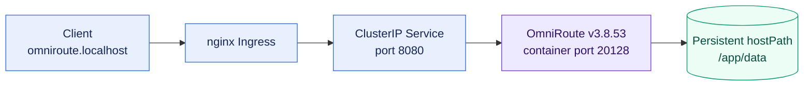

<h1 align="center">OmniRoute Kubernetes Deployment</h1>
<p align="center">
  <strong>Kubernetes manifests for running OmniRoute in a local kind cluster.</strong>
  <br />
  <em>OmniRoute v3.8.53 · Kubernetes · kind</em>
</p>

<p align="center">
  <a href="#quick-start"></a>
  <a href="LICENSE"></a>
</p>

<p align="center">
  
  
</p>

## Features

- Deploys OmniRoute as a single-replica Kubernetes Deployment.
- Exposes the application through a ClusterIP Service and nginx Ingress.
- Uses `/healthz` for startup and readiness probes.
- Mounts `/app/data` for application data persistence.

## Quick Start

The commands below target the configured local cluster context, `kind-mac-studio`.

```sh
kubectl --context kind-mac-studio apply -f k8s/omniroute-deployment.yaml
kubectl --context kind-mac-studio rollout status deployment/omniroute
kubectl --context kind-mac-studio get pods -l app=omniroute
```

The Ingress uses host `omniroute.localhost` and requires an nginx Ingress controller.

## Architecture



## Configuration

| Setting | Value | Purpose |
|---|---|---|
| Image | `diegosouzapw/omniroute:3.8.53` | OmniRoute release |
| Container port | `20128` | Application HTTP port |
| Service port | `8080` | In-cluster access |
| Health endpoint | `/healthz` | Startup and readiness checks |
| `OMNIROUTE_MEMORY_MB` | `8192` | Node.js heap setting in MB |
| Memory request / limit | `5Gi` / `10Gi` | Kubernetes scheduling and memory ceiling |
| Data mount | `/mnt/workspaces/omniroute/data` → `/app/data` | Application data directory |
| Ingress host | `omniroute.localhost` | Local HTTP hostname |

Review the hostPath for the target Kubernetes node before using this manifest outside the configured local kind environment.

## Project Structure

```text
.
├── AGENTS.md                       # Contributor and repository guidance
├── k8s/
│   └── omniroute-deployment.yaml   # Service, Deployment, and Ingress
└── data/                           # Local data directory (gitignored)
```

## Operations

Inspect application logs:

```sh
kubectl --context kind-mac-studio logs deployment/omniroute
```

Check the health endpoint from inside the pod:

```sh
kubectl --context kind-mac-studio exec deployment/omniroute -- \
  node -e 'fetch("http://127.0.0.1:20128/healthz").then(r => { console.log(r.status); process.exit(r.ok ? 0 : 1) })'
```

## Contributing

Update the Kubernetes manifest, validate it with `kubectl apply --dry-run=server -f k8s/omniroute-deployment.yaml` when the cluster is available, and verify the rollout and health endpoint after deployment. Use a concise commit message such as `chore: update OmniRoute image`.

This project is licensed under the [MIT License](LICENSE).
